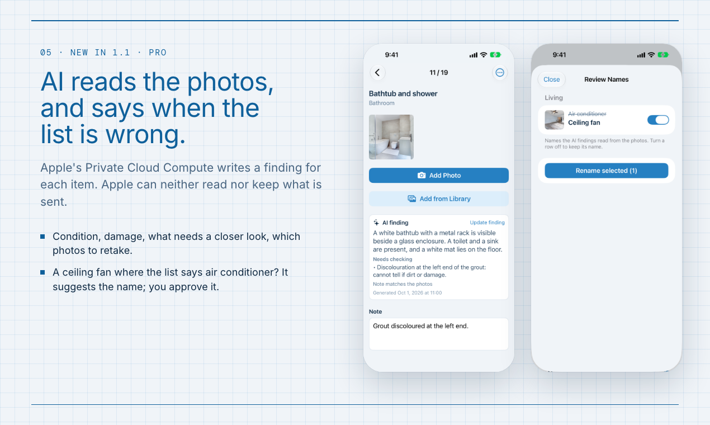
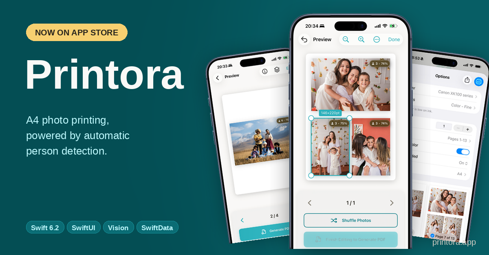

<h1 align="center">Hi, I'm Daisuke Adachi 👋</h1>

  <b>I ship complete products end to end — native iOS, native Android, and the Rails backend behind them.</b> 
  20+ years writing software · AI-driven development with Claude Code &amp; the Claude Agent SDK

  <b>Open to full-time &amp; contract roles</b> — <a href="#-get-in-touch">get in touch ↓</a>

---

I'm a full-stack mobile engineer who designs, ships, and operates **iOS** (Swift / SwiftUI / SwiftData), **Android** (Kotlin / Jetpack Compose), and **Ruby on Rails** — all three layers. I build my own products end to end, and I've also led a three-person team: as project leader on an English-vocabulary test service used by ~50,000 students at ~100 schools, I turned the publisher's requests into specs on GitHub Issues and assigned the work to the other developers. I've been shipping to the App Store and Google Play for over a decade. Based in Japan 🇯🇵, working in Japanese and English.

Since 2025 my focus has been **AI-driven development with Claude Code and the Claude Agent SDK**.

### 🚀 Recent work

  
  

- **[FieldPic Checklist](https://fieldpic.app)** — iOS 27 app for on-site photo checklists: import a CSV, photograph each item, export a ZIP or PDF report. Generates checklists on device with **Apple Intelligence (Foundation Models)**; AI Findings uses Apple's **Private Cloud Compute** to write a finding for each photo and suggest a corrected item name. Vision blur detection · 200+ unit tests (Swift Testing).
- **[Ariata](https://ariata.app)** — an instrument played by touch and AirPods head gestures; a harmony engine drives the chords. Core Motion · AVFoundation · Foundation Models "generate from mood" · 8 languages.
- **[PomoSauna](https://pomosauna.app)** — focus timer with Live Activities on the Lock Screen, Dynamic Island, and Apple Watch Smart Stack. ActivityKit · WidgetKit · StoreKit / RevenueCat.
- **[Printora](https://printora.app)** — iOS app that auto-detects people in photos and arranges them into A4-optimized print layouts. Swift / SwiftUI / SwiftData / Vision Framework · RevenueCat freemium · 491 unit tests (Swift Testing) · on the App Store since Dec 2025.
- **[CommitJobs](https://commitjobs.com)** — a job board where every participant writes code (GitHub login is the only sign-in), and one account toggles between hiring and looking — no non-technical middleman. Rails 8.1 / Hotwire / TailwindCSS v4 · Solid Queue/Cache/Cable (no Redis) · Stripe one-off listing fee (no subscriptions) · Kamal 2 → Hetzner · kept deliberately solo-maintainable.
- **[kyufy](https://kyufy.com)** — subsidy eligibility screening for Japanese businesses. Rails 8.1 · Digital Agency jGrants API · verdicts from structured data only, with no LLM in the verdict path · Stripe subscription.
- **[My Texas Method](https://mytexasmethod.com)** — Strength-training program generator based on the Texas Method. Swift 6 / Swift Charts / SwiftData + an Apple Watch companion via WatchConnectivity · 973 unit tests · **#23 on Product Hunt** (74 upvotes).
- **[NativeAppTemplate](https://nativeapptemplate.com)** — open-source, production-ready app-template suite plus an AI generator:
  - **[iOS](https://github.com/nativeapptemplate/NativeAppTemplate-Free-iOS)** (SwiftUI, **106★**) and **[Android](https://github.com/nativeapptemplate/NativeAppTemplate-Free-Android)** (Jetpack Compose, **16★**) — native templates with user authentication.
  - **[API](https://github.com/nativeapptemplate/nativeapptemplateapi)** — Rails 8.1 backend (Solid Queue / Cable / Cache, no Redis). Listed on **Awesome Rails**.
  - **[agent](https://github.com/nativeapptemplate/nativeapptemplate-agent)** — Claude Agent SDK CLI that turns a natural-language spec into a coherent three-platform SaaS (Rails API + SwiftUI iOS + Jetpack Compose Android) with structural, runtime, and vision-based validation. Built at Cerebral Valley's "Built with Opus" hackathon.

> **Contract highlight:** an iOS XCFramework that reads Japanese Residence Cards (在留カード) over NFC, built from the client's existing Android implementation and the Immigration Services Agency's public spec. The first test with real test cards failed; after re-reading the ISO standard and the Android code, it passed on the second attempt · 96% unit-test coverage.

### 🛠️ Tech I work with

### 📊 GitHub Stats

  
  

### 📫 Get in touch

I'm actively open to new opportunities — full-time or contract. I prefer environments where I can use Claude Code as my coding assistant.

- 📧 **Email:** [daisukeadachi@myturntag.com](mailto:daisukeadachi@myturntag.com)
- 💼 **LinkedIn:** [daisuke-adachi](https://www.linkedin.com/in/daisuke-adachi-8b499028/)
- 𝕏 **X:** [@AdachiDaisuke](https://x.com/AdachiDaisuke)

---

<i>Thanks for stopping by!</i>

